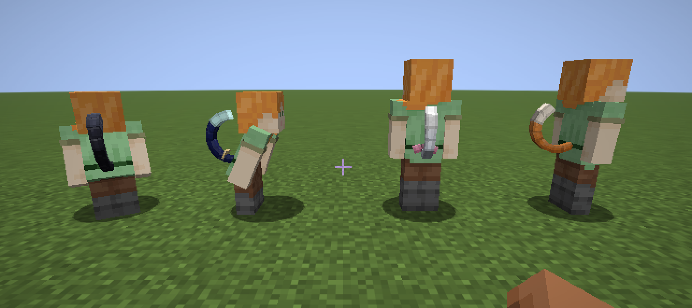
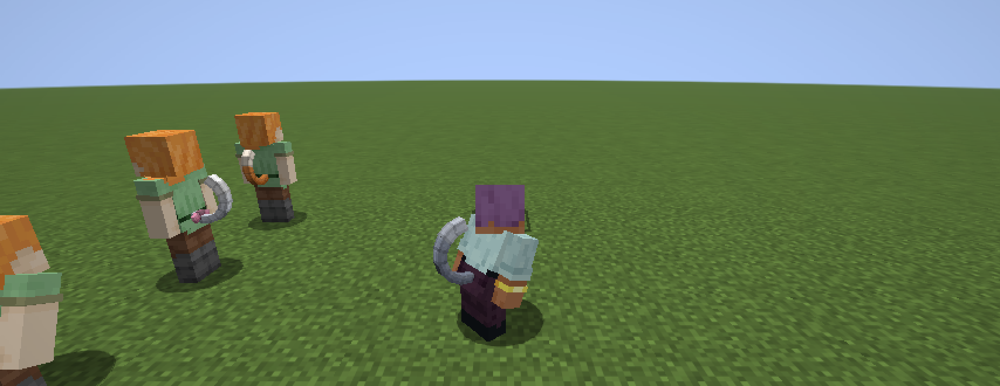
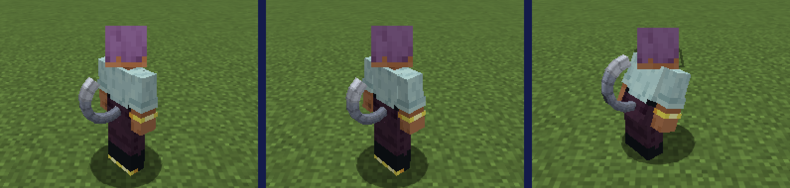

# Oxean Client

**Необязательный** клиентский мод для сервера **Oxean** (`oxean.fun`). Он делает косметику красивее и **ничего не меняет в игре**.

## Что делает

- **Хвостики «пришиты» к модели.** Без мода сервер показывает хвост отдельной сущностью, и она отстаёт от тела при резких поворотах и приседании. С модом хвост становится частью модели игрока: он крепится к пояснице, сразу поворачивается вместе с телом, приседает, плавает и летит на элитрах в том же кадре.
- **Лёгкое покачивание.** Хвост мягко покачивается на месте и чуть сильнее при ходьбе. Анимация считается у вас, сервер не нагружается.
- **Плавная серверная косметика.** Дисплеи, которые едут на игроке (косметика на других серверах), поворачиваются вместе с телом без задержки.
- Хвост не виден от первого лица, у невидимых игроков и у наблюдателей. Свой хвост видно в F5.

## Важно

- Мод **необязательный**: на Oxean можно играть и без него, хвостики видно и так, просто чуть менее плавно.
- **Только косметика**: никаких преимуществ, читов, рентгена, автокликера. Мод ничего не прячет от сервера.
- Мод разговаривает **только** с сервером, на который вы зашли, и **только** если сервер сам объявил канал `oxean:client`. Мод отправляет только свою версию и выбранный режим хвостиков. Никакой телеметрии и сторонних адресов.
- На других серверах мод ничего не отправляет, работает только сглаживание косметики на дисплеях.

## Настройки

Команда `/oxeanclient` (работает только на клиенте):
- `/oxeanclient tails native`: хвостики на модели (по умолчанию);
- `/oxeanclient tails vanilla`: как без мода;
- `/oxeanclient tails off`: не показывать хвостики вообще;
- `/oxeanclient sway on|off`: покачивание;
- `/oxeanclient smooth on|off`: сглаживание дисплеев.

Файл настроек: `config/oxean-client.json`.

## Требования

Minecraft **26.3**, Fabric Loader 0.20.1+, Fabric API.

Сервер: **oxean.fun** · Telegram: **t.me/oxean**

*Идея сглаживания дисплеев взята из мода «Smoother Server Cosmetics» (MIT). Код написан заново, чужого кода в моде нет.*

## Скачать / Download

**[Скачать последнюю версию / Download the latest version](https://github.com/HolyDanger/Oxean-Mod/releases/latest)**

Minecraft 26.3, Fabric Loader 0.20.1+, Minecraft 26.3, Fabric Loader 0.20.1+, нужен / requires [Fabric API](https://modrinth.com/mod/fabric-api).

Положите файл в папку `mods` / Put the file into your `mods` folder.

## Скриншоты / Screenshots

---

# Oxean Client

An **optional** client-side companion mod for the **Oxean** Minecraft server (`oxean.fun`). It makes cosmetics look better and **changes nothing about gameplay**.

## Features

- **Tails sewn into the player model.** Without the mod the server shows a tail as a separate display entity, and it trails behind fast body turns and sneaking. With the mod the tail is part of the player model: attached to the lower back, it turns with the body on the same frame and follows crouching, swimming and elytra poses.
- **Gentle sway.** Soft idle sway, a bit more while walking. It is computed on your client, so the server does no extra work.
- **Smoother server cosmetics.** Item/block displays riding a player (cosmetics on other servers) follow the body yaw without lag.
- Hidden in first person, for invisible players and for spectators. Your own tail shows in F5.

## Good to know

- **Optional**: you can play on Oxean without it. You still see tails, just less smooth.
- **Cosmetic only**: no advantages, no cheats, no x-ray, no automation. Nothing is hidden from the server.
- The mod talks **only** to the server you joined, and **only** if that server announces the `oxean:client` channel. It sends just its version and your tail setting. No telemetry, no third-party hosts.
- On other servers it sends nothing. Only the display smoothing is active there.

## Settings

Client-side command `/oxeanclient`:
- `/oxeanclient tails native`: tails on the model (default)
- `/oxeanclient tails vanilla`: same as without the mod
- `/oxeanclient tails off`: hide tails completely
- `/oxeanclient sway on|off`: idle sway
- `/oxeanclient smooth on|off`: display smoothing

Config file: `config/oxean-client.json`.

## Requirements

Minecraft **26.3**, Fabric Loader 0.20.1+, Fabric API.

Server: **oxean.fun** · Telegram: **t.me/oxean**

*Display smoothing is inspired by "Smoother Server Cosmetics" (MIT). Independent implementation, no code copied.*

---

© Oxean. All rights reserved. См. / See [LICENSE.txt](LICENSE.txt).
